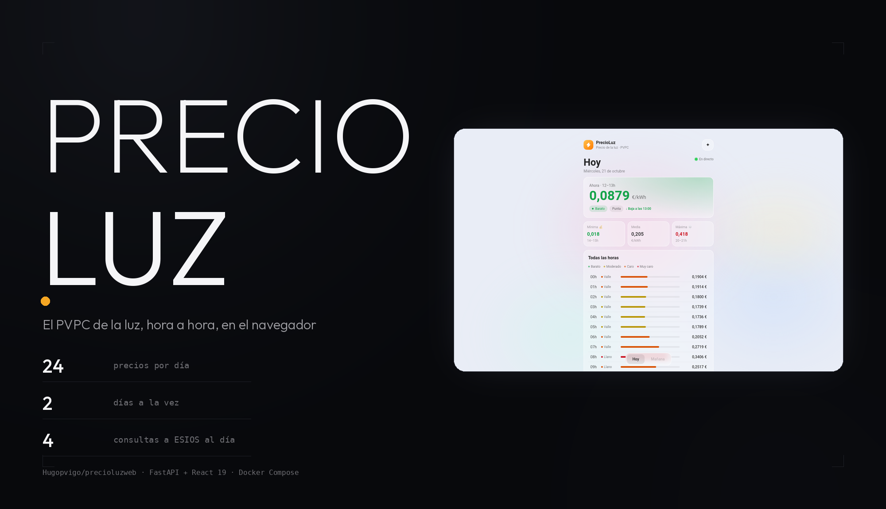
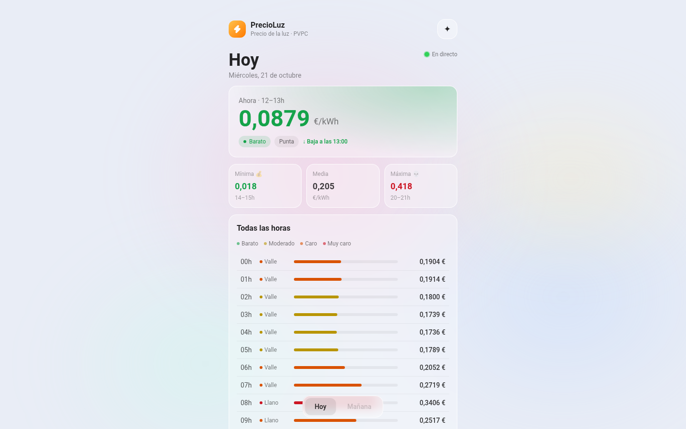

<meta property="og:title" content="PRECIOLUZWEB">
<meta property="og:description" content="El precio de la luz, hora a hora, con los datos que publica REE.">
<meta property="og:image" content="https://raw.githubusercontent.com/Hugopvigo/PrecioLuzWeb/main/docs/capturas/og.png">

<p align="center">
  
</p>

<p align="center">
  <b>El precio de la luz, hora a hora, con los datos que publica REE.</b><br>
  Un backend que habla con ESIOS y una web que pinta el PVPC como una app.
</p>

<p align="center">
  
  
  
  
  
</p>

---

## Qué es esto

El **PVPC** (Precio Voluntario al Consumidor) hora a hora de la Península, con
las tres piezas de un producto que no depende de una API lenta:

- **`server/`**: una API FastAPI que habla con ESIOS, guarda lo que ya ha
  descargado en SQLite y sirve JSON. El token de ESIOS no sale del servidor.
- **`web/`**: la SPA en React que pinta el resultado con fondo aurora, cristal y
  los colores por tramo.
- **`docker/`**: el despliegue con Docker Compose (API + web).

La web es un cliente más de esa API: el mismo endpoint que consume la
[app Android](https://github.com/Hugopvigo/PrecioLuzApp), con la misma lógica
de tramos y colores, traducida del Kotlin.


*La pantalla de hoy con los precios reales del día: precio de la hora en curso,
mínima, media y máxima, y las 24 horas ordenadas por tramo.*

## Los datos

| | |
|---|---|
| **Fuente** | indicador **1001** de la API de ESIOS, `geo_id` 8741 (Península) |
| **Formato** | 24 valores en €/kWh (el valor viene en €/MWh y se divide entre 1000) |
| **Cobertura** | hoy y mañana; mañana es `null` hasta las 20:15 |
| **Cache** | SQLite (`/data/precioluz.db`), el mismo día no se vuelve a pedir |
| **Consultas a ESIOS** | 4 al día: una a las 06:05 y tres intentos por la tarde (más una precarga al arrancar si la base está vacía) |

El planificador (APScheduler, hora de Madrid) es:

```
 06:05  ──  actualiza los precios de hoy y borra los de anteayer
 20:15  ──  intento 1: precios de mañana
 20:45  ──  intento 2: si el anterior falló
 21:30  ──  intento 3: último intento
```

REE publica los precios del día siguiente entre las 20:00 y las 20:30, así que
los tres intentos cubren publicaciones tardías.

Cada hora del día se etiqueta con un **tramo** (Valle, Llano o Punta, según
la hora y si es fin de semana) y un **nivel** (Barato, Moderado, Caro, Muy
caro), repartiendo las 24 horas en cuatro bloques de seis según su posición
en el ranking de precio.

## API

`GET /api/precios` — 20 peticiones por minuto y por IP, con
`Cache-Control: public, max-age=1800`:

```json
{
  "updated_at": "2026-05-31T21:30:00+02:00",
  "today":    { "date": "2026-05-31", "prices": [0.061, 0.058, "…"] },
  "tomorrow": { "date": "2026-06-01", "prices": [0.072, 0.068, "…"] }
}
```

`GET /api/health` — para el healthcheck del contenedor:

```json
{ "status": "ok" }
```

## Desarrollo local

Dos procesos, con el proxy de Vite ya apuntando al backend:

```bash
# frontend (Vite en :5173)
npm install
npm run dev

# backend (FastAPI en :8000)
cd server
pip install -r requirements.txt
uvicorn server.main:app --reload --port 8000
```

## Despliegue

Docker Compose levanta los dos servicios: la API en la red interna de Compose
y la web en el puerto 8081, con nginx haciendo de proxy de `/api` e inyectando
`X-Real-IP` para que el rate limit sea por IP real.

```bash
cp .env.example .env      # y poner ESIOS_API_TOKEN
docker compose -f docker/docker-compose.yml up -d --build
```

Variables de entorno (por nombre, en [`.env.example`](.env.example)):

| Variable | Para qué |
|---|---|
| `ESIOS_API_TOKEN` | token de ESIOS/REE — obligatorio |
| `TZ` | zona horaria (`Europe/Madrid`) |
| `LOG_LEVEL` | `INFO` (por defecto) o `DEBUG` |

El compose deja la base de datos en el volumen `data/` y el healthcheck de la
API en `/api/health`; la web solo arranca cuando la API está sana.

## Cómo está hecho

```
precioluzweb/
├── docs/capturas/            capturas de la web
├── server/
│   ├── main.py          FastAPI, rate limit y ciclo de vida
│   ├── scheduler.py     los 4 trabajos del día
│   ├── esios.py         consulta a ESIOS (solo Península)
│   ├── db.py            SQLite asíncrono
│   └── requirements.txt
├── web/
│   └── src/
│       ├── components/  AuroraBackground, GlassCard, HeroPriceCard, HourList…
│       ├── hooks/       usePrices (TanStack Query)
│       ├── types.ts     tipos del dominio
│       └── utils.ts     tramos, niveles y ventanas baratas/carias
└── docker/
    ├── docker-compose.yml
    ├── Dockerfile.api
    ├── Dockerfile.web
    └── nginx.conf
```

Stack: **FastAPI** + `uvicorn` + `aiohttp` + `aiosqlite` + **APScheduler** +
`slowapi` en el servidor; **React 19**, **Vite 8**, **TypeScript 7**,
**Tailwind CSS 4** y **TanStack Query 5** en la web.

## Licencia

Bajo **CC BY-NC-SA 4.0**: compartir con atribución, sin uso comercial y bajo
la misma licencia. Consulta [LICENSE](LICENSE) para el texto completo.
